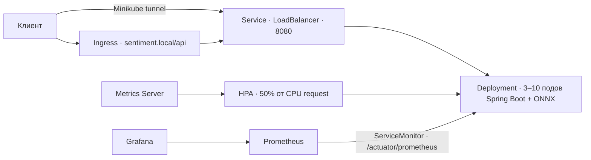

# Анализ тональности текста в Kubernetes

Учебный проект по разработке и развёртыванию ИИ-приложения в Minikube. REST API принимает текст, передаёт его классификатору Inference4J с ONNX Runtime и возвращает метку класса с наибольшей оценкой. Приложение написано на Java 25 и Spring Boot. Метрики публикует Spring Boot Actuator, собирает Prometheus и отображает Grafana.

## Результаты развёртывания

Проект выполнил Граблевский М. В. Сборка выполнялась на хосте, а Minikube с драйвером Docker запускался в виртуальной машине под VMware Workstation. Результаты ниже зафиксированы в отчёте `orchestra.pdf` от 23 ноября 2026 г.

| Проверка | Результат | Страницы отчёта |
| --- | --- | --- |
| Docker | Для `sentiment-app:local` команда `docker images` показала **137 MB** в колонке `CONTENT SIZE` и **362 MB** в колонке `DISK USAGE`. Порог 150 MB соблюдён по размеру содержимого образа. | 14–16 |
| Minikube | Кластер из двух узлов с дополнениями Ingress и Metrics Server. | 35–37 |
| HPA | На первом снимке видно 10 работающих реплик, на более позднем — 3. Стартовая нагрузка при инициализации модели указана в отчёте как возможная причина всплеска. | 39–40 |
| API | Service получил внешний IP через `minikube tunnel`. Запрос к `sentiment.local/api/sentiment?text=I+love+this` вернул `{"sentiment":"positive"}`. | 41–47 |
| Мониторинг | Цели приложения в Prometheus имели статус `UP`. В Grafana отображались метрики HTTP и JVM для выбранного пода. | 51–59 |

## Архитектура



| Файл | Назначение |
| --- | --- |
| [SentimentController.java](src/main/java/com/example/sentiment_app/controllers/SentimentController.java) | Обработчик `GET /api/sentiment?text=...` |
| [application.yaml](src/main/resources/application.yaml) | Включение классификатора и эндпоинтов Actuator |
| [Dockerfile](Dockerfile) | Многоэтапная сборка контейнера с сокращённой Java-средой через `jlink` |
| [deployment.yaml](k8s/deployment.yaml) | Три начальные реплики и отдельный кэш модели `emptyDir` на время жизни каждого пода |
| [service.yaml](k8s/service.yaml) | Сервис `LoadBalancer`, который направляет запросы к репликам |
| [ingress.yaml](k8s/ingress.yaml) | Маршрутизация для хоста `sentiment.local` |
| [hpa.yaml](k8s/hpa.yaml) | Масштабирование от 3 до 10 реплик по средней загрузке CPU |
| [servicemonitor.yaml](k8s/servicemonitor.yaml) | Сбор метрик с каждой реплики каждые 15 секунд |

## Локальный запуск и сборка образа

Понадобятся JDK 25, Docker с работающим демоном, Minikube, `kubectl`, Helm и `curl`. Команды приведены для Bash. Для первой сборки нужен доступ к репозиторию Maven. При первом запуске с пустым кэшем Inference4J загружает модель DistilBERT, дообученную на англоязычном наборе SST-2, с Hugging Face. Примеры запросов используют английский текст.

Из корня репозитория соберите JAR и запустите тесты через Maven Wrapper:

```bash
java -version
./mvnw clean verify
docker build -t sentiment-app:local .
docker image ls sentiment-app:local
```

Сравнивайте размер содержимого образа по колонке `CONTENT SIZE`. При первом запуске модель загружается отдельно, а при следующих запусках Docker может использовать файлы из примонтированного каталога.

Для проверки контейнера запустите его в отдельном терминале:

```bash
mkdir -p "$HOME/sentiment-model-cache"
docker run --rm -p 127.0.0.1:8080:8080 \
  -v "$HOME/sentiment-model-cache:/app/model-cache" sentiment-app:local
```

После запуска приложения выполните запросы:

```bash
curl -fsS http://127.0.0.1:8080/actuator/health
curl -fsSG http://127.0.0.1:8080/api/sentiment \
  --data-urlencode 'text=I love this'
curl -fsSG http://127.0.0.1:8080/api/sentiment \
  --data-urlencode 'text=This was a terrible experience.'
```

Пример ответа: `{"sentiment":"positive"}`. Значение поля определяется классификатором. Для запуска без Docker используйте `java --enable-native-access=ALL-UNNAMED -jar target/sentiment-app-0.0.1-SNAPSHOT.jar`.

## Развёртывание в Minikube

Установите Minikube по инструкции для своей ОС. Ниже используется драйвер Docker. [Официальная инструкция Minikube](https://minikube.sigs.k8s.io/docs/start/)

```bash
minikube version
minikube start --driver=docker --cpus=4 --memory=8192mb --nodes=2
kubectl config use-context minikube
minikube status
kubectl get nodes -o wide

minikube addons enable ingress
minikube addons enable metrics-server
kubectl -n ingress-nginx rollout status deployment/ingress-nginx-controller --timeout=300s

minikube image load --daemon sentiment-app:local
```

Если образ собран на хосте, а Minikube работает в виртуальной машине, используйте способ из отчёта. На хосте выполните `docker save -o sentiment-app.tar sentiment-app:local`, перенесите архив и каталог `k8s/` в виртуальную машину, затем выполните в ней `minikube image load sentiment-app.tar`. Загрузите образ одним из этих способов до применения Deployment с `imagePullPolicy: Never`.

```bash
kubectl -n default apply -f k8s/deployment.yaml -f k8s/service.yaml \
  -f k8s/ingress.yaml -f k8s/hpa.yaml
```

В исходном манифесте Ingress аннотация `rewrite-target: /` заменяет путь запроса на `/`. Следующая команда настраивает маршрут `/api` в кластере и сохраняет исходный путь до контроллера. Выполните её снова после повторного применения исходного манифеста.

```bash
kubectl -n default patch ingress sentiment-ingress --type=json -p='[
  {"op":"remove","path":"/metadata/annotations/nginx.ingress.kubernetes.io~1rewrite-target"},
  {"op":"replace","path":"/spec/rules/0/http/paths/0/path","value":"/api"}
]'
kubectl -n default rollout status deployment/sentiment-app --timeout=300s
kubectl -n default get deployment,pods,svc,ingress,hpa -o wide
kubectl -n default get endpointslice -l kubernetes.io/service-name=sentiment-service -o wide
```

### Доступ к API

Для проверки Service типа `LoadBalancer` запустите `minikube tunnel` в отдельном терминале и оставьте его открытым. Затем возьмите внешний адрес из вывода `kubectl -n default get svc sentiment-service`. [Доступ к сервисам Minikube](https://minikube.sigs.k8s.io/docs/handbook/accessing/)

```bash
LB_IP=$(kubectl -n default get svc sentiment-service \
  -o jsonpath='{.status.loadBalancer.ingress[0].ip}')
curl -fsSG "http://${LB_IP}:8080/api/sentiment" \
  --data-urlencode 'text=I love this'
```

В отчёте имя `sentiment.local` сопоставлено с IP Minikube в `/etc/hosts` внутри виртуальной машины. Для проверки маршрута Ingress передайте имя хоста через `--resolve`, чтобы обойтись без записи в системном файле `hosts`. На Linux с драйвером Docker используйте IP Minikube. При использовании Docker Desktop следуйте инструкции Minikube для Ingress через туннель.

```bash
curl -fsSG --resolve "sentiment.local:80:$(minikube ip)" \
  http://sentiment.local/api/sentiment --data-urlencode 'text=I love this'
```

### Проверка HPA

Дождитесь появления метрик CPU. HPA использует Metrics Server и рассчитывает загрузку относительно запроса CPU `100m` на под. Цель `50%` соответствует средней загрузке `50m` на под.

```bash
kubectl -n default top pods -l app=sentiment-app
kubectl -n default get hpa sentiment-hpa --watch
```

В другом терминале запустите нагрузку внутри кластера через Service. Восемь параллельных циклов посылают запросы в течение трёх минут. Зафиксируйте CPU и число реплик до, во время и после нагрузки. Масштабирование вверх происходит, когда измеряемая нагрузка превышает целевое значение.

```bash
kubectl -n default run sentiment-load --rm -i --restart=Never --image=busybox:1.37 \
  -- /bin/sh -c '
    for worker in 1 2 3 4 5 6 7 8; do
      timeout 180 sh -c "while true; do wget -q -O /dev/null http://sentiment-service:8080/api/sentiment?text=excellent || sleep 1; done" &
    done
    wait
  '
```

## Prometheus и Grafana

Установите `kube-prometheus-stack` в пространство имён `monitoring`. Имя релиза `monitoring` совпадает с меткой `release` в ServiceMonitor. Настройка выбора пространств имён явно включает `default`, где находится ServiceMonitor приложения. [Документация Helm-чарта](https://github.com/prometheus-community/helm-charts/tree/main/charts/kube-prometheus-stack)

```bash
helm repo add prometheus-community https://prometheus-community.github.io/helm-charts
helm repo update
helm upgrade --install monitoring prometheus-community/kube-prometheus-stack \
  --namespace monitoring --create-namespace --wait --timeout 10m \
  --set-json 'prometheus.prometheusSpec.serviceMonitorNamespaceSelector={"matchExpressions":[{"key":"kubernetes.io/metadata.name","operator":"In","values":["default","monitoring"]}]}'
kubectl wait --for=condition=Established crd/servicemonitors.monitoring.coreos.com --timeout=120s
kubectl -n default apply -f k8s/servicemonitor.yaml
kubectl -n monitoring get pods,svc
```

Откройте два проброса портов в отдельных терминалах:

```bash
kubectl -n monitoring port-forward svc/monitoring-kube-prometheus-prometheus 9090:9090
```

```bash
kubectl -n monitoring port-forward svc/monitoring-grafana 3000:80
```

В Prometheus откройте `http://localhost:9090/targets` и найдите цели `serviceMonitor/default/sentiment-app-monitor/0` со статусом `UP`. В Grafana откройте `http://localhost:3000`, войдите как `admin` и прочитайте пароль из секрета:

```bash
kubectl -n monitoring get secret monitoring-grafana \
  -o jsonpath='{.data.admin-password}' | base64 --decode
```

В Grafana откройте **Dashboards → Import**, введите ID `22108`, нажмите **Load**, выберите источник **Prometheus** и нажмите **Import**. В фильтрах выберите пространство имён `default`, сервис `sentiment-service` и один из подов. Отправьте несколько запросов к API, чтобы получить данные для HTTP-панелей. [JVM SpringBoot3 dashboard (for Prometheus Operator)](https://grafana.com/grafana/dashboards/22108-jvm-springboot3-dashboard-for-prometheus-operator/)

Для проверки отдельных метрик в Prometheus или Grafana Explore используйте выражения PromQL:

| Панель | Запрос |
| --- | --- |
| Доступность реплик | `up{namespace="default",service="sentiment-service"}` |
| Запросы в секунду | `sum(rate(http_server_requests_seconds_count{application="sentiment-app",uri="/api/sentiment"}[2m]))` |
| Среднее время ответа, с | `sum(rate(http_server_requests_seconds_sum{application="sentiment-app",uri="/api/sentiment"}[2m])) / sum(rate(http_server_requests_seconds_count{application="sentiment-app",uri="/api/sentiment"}[2m]))` |
| Загрузка CPU процесса по подам, от 0 до 1 | `process_cpu_usage{application="sentiment-app"}` |

## Диагностика

| Симптом | Что проверить |
| --- | --- |
| `ErrImageNeverPull` | Имя и тег образа, затем повторите `minikube image load --daemon sentiment-app:local`. |
| Приложение перезапускается | Посмотрите `kubectl -n default logs POD --previous` и `kubectl -n default describe pod POD`. Проверьте доступ пода к источнику модели. |
| Ingress возвращает `404` | Проверьте хост `sentiment.local`, путь `/api` и отсутствие аннотации `rewrite-target` у ресурса в кластере. |
| `EXTERNAL-IP` в состоянии `<pending>` | Проверьте, что запущен `minikube tunnel`. |
| HPA показывает `<unknown>` | Проверьте `kubectl top pods`, состояние Metrics Server и запрос CPU у контейнера. |
| Отдельные цели управляющего слоя имеют статус `DOWN` | В отчёте Prometheus зафиксировал `connection refused` при обращении к портам компонентов Minikube. Проверяйте статус целей `sentiment-app-monitor` отдельно. |
| Цели приложения отсутствуют в Prometheus | Проверьте пространство имён и метку `release: monitoring` у ServiceMonitor, именованный порт `http` у Service и доступность `/actuator/prometheus`. |

## Отчёты

См. каталог doc в корневом каталоге проекта.

- `orchestra.pdf` содержит пошаговое развёртывание, манифесты, выводы команд и скриншоты.
- `report.pdf` содержит отдельный аналитический обзор трёх препринтов arXiv за 2025–2026 годы. Исходник обзора — `report.odt`.
